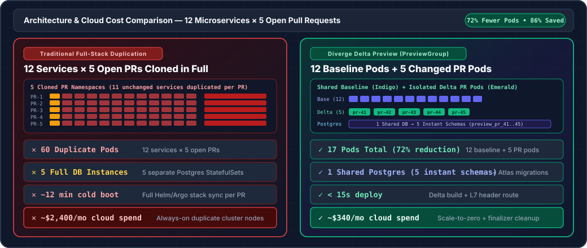
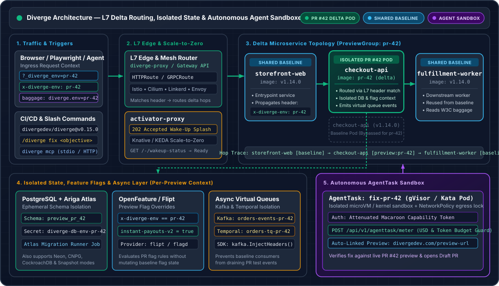

<p align="center">
  
</p>

<h1 align="center">Diverge</h1>
<p align="center"><em>Branch your infrastructure, not just your code.</em></p>

<p align="center">
  <a href="https://github.com/divergedev/diverge/actions/workflows/ci.yml"></a>
  <a href="https://github.com/divergedev/diverge/blob/main/LICENSE"></a>
  <a href="https://github.com/divergedev/diverge"></a>
  <a href="https://github.com/divergedev/diverge/releases/latest"></a>
</p>

Environment-as-a-service engine for Kubernetes. Diverge creates ephemeral preview environments with async routing, Prometheus observability, GitLab support, SDK propagation, and configurable database provisioning. Extensible via a pluggable provider registry.

### Get Started

```bash
curl -fsSL https://raw.githubusercontent.com/divergedev/diverge/main/install.sh | sh
```

Documentation: [https://divergedev.com](https://divergedev.com)
- [Why Diverge? (Architecture & Cost Comparison)](docs/guides/why-diverge.md)
- [2-Minute Local Quickstart (Kind + Helm)](docs/guides/quickstart-local.md)
- [Fullstack Multi-Service Demo Monorepo (`examples/fullstack-demo/`)](docs/guides/fullstack-demo.md)
- [Autonomous Agent Sandboxes & Capability Auth](docs/guides/agent-sandboxes.md)
- [MCP Server & IDE Integration Guide](docs/guides/mcp-server.md)
- [Database Branching & Atlas Migrations](docs/guides/database-branching-atlas.md)
- [CI/CD Workflows (GitHub Actions & GitLab CI)](docs/guides/ci-cd-workflows.md)
- [Web Dashboard & OIDC Setup](docs/guides/dashboard-and-oidc.md)
- [Service Mesh & Gateway API Chooser](docs/guides/routing-and-mesh-chooser.md)
- [Scale-to-Zero & Activator Proxy Guide](docs/guides/scale-to-zero.md)
- [Feature Flags & OpenFeature Guide](docs/guides/feature-flags.md)
- [Multi-User Dev & Conflict Detection (Pro)](docs/guides/multi-user-dev.md)
- [Hot Reload Guide](docs/guides/hot-reload.md)
- [Observability Guide](docs/guides/observability.md)
- [CLI Reference](docs/guides/cli-reference.md)
- [Topology & Route Simulation](docs/guides/cli-reference.md#diverge-route)
- [Header Propagation & SDK Starter Kits](docs/header-propagation.md)
- [Write a Custom Provider in 50 Lines](docs/guides/custom-providers.md)
- [Troubleshooting & `diverge doctor` Playbook](docs/guides/troubleshooting.md)

## Try It

> **[In-Repo Fullstack Demo (`examples/fullstack-demo/`) →](examples/fullstack-demo/)** — Runnable 3-service Go monorepo (`storefront-web`, `checkout-api`, `fulfillment-worker`) showcasing delta `PreviewGroup` deploys, header propagation, PostgreSQL schema-per-PR + Atlas migrations, Flipt feature overrides, scale-to-zero hibernation, and `AgentTask` gVisor sandboxes.
>
> **[5-minute demo →](https://github.com/divergedev/demo)** — Multi-repo preview environments with k3d + Envoy Gateway. Features a complete hands-on bank-demo showcasing database schema isolation and automated migration jobs!

## Quick Start

<p align="center">
  
</p>

You can quickly test Diverge locally with the CLI:

```bash
diverge dev --service my-app
```

### How It Works: Delta Previews vs. Full-Stack Duplication

<p align="center">
  
</p>

### Turnkey CI/CD (`divergedev/diverge@v0.16.0`)

Deploy a delta `PreviewGroup` for only the services modified in a Pull Request and pass `routing-header-json` directly into Playwright E2E tests:

```yaml
- name: Deploy Diverge Delta Preview
  id: diverge
  uses: divergedev/diverge@v0.16.0
  with:
    kubeconfig: ${{ secrets.PREVIEW_KUBECONFIG }}
    image-registry: ghcr.io/acme
    base-url: https://staging.example.com
    wait: "true"

- name: Run Playwright E2E Against Preview
  if: steps.diverge.outputs.skipped != 'true'
  run: npx playwright test
  env:
    PREVIEW_URL: ${{ steps.diverge.outputs.preview-url }}
    EXTRA_HTTP_HEADERS: ${{ steps.diverge.outputs.routing-header-json }}
```

## Helm Install

```bash
helm install diverge oci://ghcr.io/divergedev/charts/diverge --version <version>
```

See [charts/diverge/values.yaml](charts/diverge/values.yaml) for configuration options.

## Key Features
*   **Autonomous Agent Sandboxes (`AgentTask`)**: Run AI coding agents inside isolated Kubernetes sandboxes (`gvisor` / `kata` / `agent-sandbox`) with attenuated **Macaroon capability tokens**, network policy egress lockdowns, automatic linked preview environments (`PreviewEnvironmentReady` condition, `divergedev.com/preview-url` annotation), and live LLM cost/token metering via `POST /api/v1/agenttask/meter`.
*   **PreviewGroup Orchestration**: Manage multiple child environments and services under a single CR tied directly to an MR/PR. Automatic orphan cleanup and label-based ownership.
*   **Provider Registry**: Pluggable, extensible architecture — add new routing, deployer, notifier, sandbox, or database providers with a single file. Zero changes to the controller.
*   **Scale-to-Zero**: Idle preview environments automatically scale to zero via KEDA HTTP Add-on (`HTTPScaledObject`) or annotation-based idle hibernation (`divergedev.com/hibernate-after`, `divergedev.com/last-traffic-at`). The interceptor wakes up pods on the first request, resulting in 90%+ resource savings for idle MRs.
*   **Activator Proxy (`activator-proxy`)**: Smart routing that directs traffic to the pod when ready. Includes `X-Preview-Env` header injection, a shared informer for efficient pod state tracking, and an optional auto-refreshing HTML wake-up splash page (`--wake-splash` flag / `X-Diverge-Wake-Splash: true` header and `GET /-/wakeup-status` readiness endpoint).
*   **Delta Deployment**: Only deploy what changed, falling back to a baseline for unmodified services.
*   **Header-Based Routing & Gateway API**: Leverages Gateway API (`HTTPRoute` + `GRPCRoute` + cross-namespace `ReferenceGrant`), Istio (`ambient-mesh` / `waypoint`), Cilium, Linkerd, and the Diverge Proxy to route traffic seamlessly using HTTP/gRPC headers.
*   **Configurable DB Modes & Atlas Migrations**: Options for `shared`, `schema`, `snapshot`, or `fresh` databases via in-cluster `schema` and CloudNativePG (`cnpg`) providers, plus native [Atlas Operator](docs/guides/database-branching-atlas.md) (`AtlasMigration` / `AtlasSchema`) integration.
*   **Schema-per-Environment**: Actual execution of SQL-based schema provisioning (via `SQLExecutor`) with `public` schema write-protection, declarative `seedSource` seeding (`public`, `schema:<name>`, `configmap:<name>[/<key>]`), regex-validated naming, injection prevention, auto-generated `diverge-db-env-<env>` Secret (`DATABASE_URL` and `DIVERGE_PREVIEW_SCHEMA`), and automated migration Jobs.
*   **MR-Triggered Lifecycle**: Environments spin up when a Merge Request opens and tear down upon merge/close.
*   **Merge Gating**: GitLab/GitHub commit status checks (`diverge/preview`) block merges until environments are healthy.
*   **Argo CD & Direct Deploy**: Argo CD GitOps (`Application` CRs) and No-ArgoCD mode (`DirectDeployer`) for Helm charts and Kustomize overlays.
*   **Feature Flags & OpenFeature**: Isolated flag evaluation per preview environment. Out-of-the-box support for in-cluster `flagd` ConfigMaps, remote [Flipt](https://flipt.io) ephemeral namespaces, [Flagsmith](https://www.flagsmith.com) ephemeral identities, and [Unleash](https://www.getunleash.io) context-constrained strategies with automated cleanup on MR merge.
*   **Environment Export**: `diverge env export` extracts environment variables from preview pods for local development (dotenv, JSON, shell formats).
*   **Test Integration**: CI trigger and polling support to run automated tests against preview environments.
*   **Prometheus Metrics**: Reconciliation duration, deployment status, route counts, active environments, preview group gauges, per-environment cost estimation (`diverge_environment_estimated_hourly_cost_usd`), and idle hibernation tracking (`divergedev.com/hibernate-after`, `divergedev.com/last-traffic-at`).
*   **Namespace Labels**: Custom labels on preview namespaces (e.g., `istio.io/dataplane-mode: ambient` for zero-trust mTLS).
*   **Security Hardened**: Macaroon capability tokens, webhook secret constant-time comparison, RFC 7230 header validation, safe SHA handling, ArgoCD namespace bypass prevention, IPv6-safe pod URLs, typed Server-Side Apply (SSA), and strict label validation.
*   **Finalizer-Based Lifecycle**: Kubernetes finalizers ensure clean teardown of all resources (routing, database, sandboxes, ArgoCD apps) even during force-deletes.
*   **TTL Auto-Expiry**: Automatic environment cleanup after configurable TTL with requeue-based expiry.
*   **Multi-SCM Notifiers & Webhooks**: GitLab MR comments and GitHub PR comments with status updates and interactive PR/MR slash commands (`/diverge preview`, `/diverge fix <objective>`, `/diverge extend-ttl [duration]`, `/diverge teardown`, `/diverge pause`, `/diverge resume`).
*   **E2E Tested**: End-to-end tests with Kind/k3d, Envoy Gateway, Istio, Cilium, Linkerd, and real CRD reconciliation.
*   **ConnectRPC API Server & Web Dashboard**: Opt-in API server (`server.enabled: true` in Helm) featuring an embedded React Web UI (`server.dashboard.enabled: true`), ConnectRPC (HTTP/1.1 + HTTP/2), OIDC JWT + K8s TokenReview + Macaroon authentication, namespace-scoped RBAC authorization, structured audit logging, list pagination, optimistic concurrency, and HTTP reverse tunnels.
*   **Service Topology & Route Simulation**: `diverge route <service>` traces request paths through your service graph. `diverge graph show` renders the topology as Mermaid, DOT, or JSON.
*   **Changed-Service Detection**: `diverge diff` identifies which services are affected by your code changes using git diff + path-based service mapping. Outputs JSON for CI integration.
*   **Prometheus Topology Discovery**: Auto-discovers service dependencies from Istio, Linkerd, or Cilium mesh metrics. Background cache with stale-while-revalidate for zero-latency CLI responses.

### Async Routing

Diverge provides fully isolated preview environments for asynchronous workloads.
*   **Subdomain vs Header Routing**: Use `mode: subdomain` for frontend-to-backend workflows without passing custom headers.
*   **Available Providers**: Supported provisioners include Temporal, Kafka (with bounded topic `retention.ms` via `divergedev.com/kafka-retention-ms` or TTL), Noop, and Webhook.
*   **Slim Builds**: Use `no_temporal` and `no_kafka` build tags for smaller binaries.

See the [Async Routing Guide](https://divergedev.com/guides/async-routing/) for full configuration details and YAML examples.

## Security

Diverge takes security seriously. The platform features strict CRD OpenAPI validation, context timeouts on all external calls, and prevention mechanisms for shell/markdown injection in templates. The controller uses RBAC-scoped clients to ensure it only has the permissions it needs. Webhook interactions are secured using constant-time comparisons for secrets and RFC 7230-compliant header validation. Recent hardening includes Macaroon capability auth with namespace-scoped secret indexing, ArgoCD namespace bypass prevention, safe SHA handling to eliminate panics, IPv6-safe pod URLs, comprehensive label validation, and Typed Server-Side Apply (SSA) to ensure safe resource updates.

- Container images are signed with [cosign](https://github.com/sigstore/cosign) using keyless (OIDC) identity
- Every release includes an SBOM (SPDX) attached to the container image
- CRD YAML bundles are published as release artifacts
- Helm chart is published to `oci://ghcr.io/divergedev/charts`
- GitHub Actions are pinned to commit SHAs

## Architecture

<p align="center">
  
</p>

Diverge consists of 5 core binaries and an embedded Web UI compiled and released via `goreleaser`:

1.  **Controller (`diverge-controller`)**: The Kubernetes operator that watches `PreviewGroup`, `Environment`, and `AgentTask` Custom Resources (CRs), reconciles them, and provisions routing, databases, sandboxes, and GitOps resources.
2.  **API Server & Web UI (`diverge-server`)**: ConnectRPC server (`server.enabled: true`) serving the embedded React Web Dashboard, OIDC/TokenReview/Macaroon authentication, real-time environment/log streaming, and local-to-cluster HTTP tunnels.
3.  **Proxy (`diverge-proxy`)**: A reverse proxy that facilitates header-based L7 routing to preview environments.
4.  **Activator (`activator-proxy`)**: A proxy for scale-to-zero workloads. Wakes up sleeping pods on the first request and seamlessly routes traffic once they are ready.
5.  **CLI & MCP Server (`diverge`)**: Terminal CLI and stdio Model Context Protocol (`diverge mcp`) server for AI agents and IDEs.

## PreviewGroup Example

A minimal `PreviewGroup` Custom Resource managing multiple services for a single MR:

```yaml
apiVersion: divergedev.com/v1alpha1
kind: PreviewGroup
metadata:
  name: mr-42
spec:
  source:
    provider: gitlab
    project: myorg/platform
    branch: feat/payments
  routing:
    headerKey: x-preview-env
    headerValue: "42"
  services:
    - name: payments-api
      image: registry.example.com/payments:mr-42
      mode: image
      port: 8080
    - name: gateway
      mode: baseline
```

## CLI Commands

The `diverge` CLI helps you manage environments efficiently:
*   `diverge init` - Initialize a `.diverge.yaml` config or local Kubernetes playground
*   `diverge create` - Create a new environment
*   `diverge curl` - Send HTTP requests to a preview environment and compare against baseline (`--compare-baseline`)
*   `diverge list` - List active environments
*   `diverge status` - Check the status of an environment
*   `diverge top` - Live terminal dashboard (`watch`) of environments, FinOps burn rate, hibernation state, and `AgentTask`s
*   `diverge open` - Open the preview URL in your browser (`--magic` for one-click `?_diverge_env=` cookie URL)
*   `diverge logs` - Stream logs for a preview environment
*   `diverge dev` - Local development mode with preview routing
*   `diverge doctor` - Diagnose cluster, CRD, Gateway, and environment health
*   `diverge env export` - Export environment variables (dotenv, JSON, shell)
*   `diverge mcp` - Run MCP server over stdio (`diverge mcp setup` to auto-configure Cursor, Claude Code, and Windsurf)
*   `diverge preview` - Create preview environments from CLI
*   `diverge validate` - Validate your `.diverge.yaml`
*   `diverge delete` - Delete an environment
*   `diverge version` - Show CLI version

## Installation

Install via shell script:

```bash
curl -fsSL https://divergedev.com/install.sh | sh
```

Or download and verify first:
```bash
curl -fsSL -o install.sh https://divergedev.com/install.sh
sha256sum install.sh  # verify contents
sh install.sh
```

Or install via Go:

```bash
go install github.com/divergedev/diverge/cmd/diverge@latest
```

### Install via Helm (Kubernetes Operator)

```bash
helm repo add diverge https://divergedev.github.io/diverge
helm repo update
helm install diverge diverge/diverge --namespace diverge-system --create-namespace
```

### Docker Images (for reference)

The controller, server, and proxy images are available at:
```bash
docker pull ghcr.io/divergedev/diverge:latest
```

Or download the binary from [Releases](https://github.com/divergedev/diverge/releases).

## Development

Diverge supports both **1-click GitHub Codespaces / VS Code Dev Containers** (`.devcontainer/devcontainer.json`) and **Nix** (`flake.nix`).

```bash
# Enter the Nix development shell
nix develop

# Apply CRDs and run locally
nix develop -c make install
nix develop -c make run
```

See [CONTRIBUTING.md](CONTRIBUTING.md) for the full developer guide, testing conventions, and Property-Based Testing (PBT) workflow using the Hegel framework (`hegel.dev/go/hegel`).

## Contributing

See [CONTRIBUTING.md](CONTRIBUTING.md) and [GitHub Issues](https://github.com/divergedev/diverge/issues) for planned features and open work.

## License
Apache 2.0
