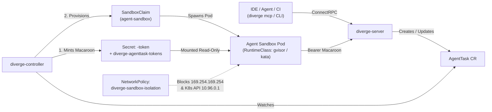

# Autonomous Agent Sandboxes & Capability Auth

Diverge includes a Kubernetes-native execution engine for autonomous coding agents (`AgentTask`). Each task runs inside a network-isolated sandbox pod (`kubernetes-sigs/agent-sandbox`), authenticates with an attenuated **Macaroon capability token**, and enforces strict iteration, USD cost, token, and wall-clock timeout guardrails.

---

## 1. Architecture Overview



### Key Security Properties
1. **Attenuated Macaroon Capability Tokens**:
   - Minted by `diverge-controller` using HMAC-SHA256 chained caveats (`task_id`, `namespace`, `repo`, `branch`, `tools`, `models`, `max_cost_usd`, `max_tokens`, `expires`).
   - Mounted read-only into the sandbox pod at `/etc/diverge/token/token`.
   - Verified by `diverge-server` against the namespace-scoped index Secret (`diverge-agenttask-tokens`) and live `AgentTask` phase (`Active`).
2. **Revocation on Pause, Budget Exceeded, or Completion**:
   - Setting `spec.suspended: true` or exceeding `maxIterations`, `budgetUSD`, or `budgetTokens` transitions the task to `Paused` and marks the token revoked in `diverge-agenttask-tokens` once reconciled by the controller.
   - Resuming a paused task mints a fresh capability token with updated budget/expiry caveats.
3. **Defense-in-Depth Network Isolation**:
   - The default `NetworkPolicy` (`<release>-sandbox-isolation`) denies all ingress to sandbox pods, restricts egress to DNS (53) and HTTPS/SSH (443/22), and blocks cloud metadata (`169.254.169.254/32`, `169.254.0.0/16`) and the in-cluster Kubernetes API (`10.96.0.1/32`).
   - Pod specs set `AutomountServiceAccountToken: false`, `ReadOnlyRootFilesystem: true` (with writable `emptyDir` mounts at `/workspace` and `/tmp`), `RunAsNonRoot: true`, and drop `ALL` Linux capabilities.

---

## 2. Enabling Agent Sandboxes in Helm

1. Create a 32-byte Macaroon root key Secret in the controller namespace:

```bash
kubectl create secret generic diverge-macaroon-root-key \
  -n diverge-system \
  --from-literal=root-key="$(openssl rand -hex 32)"
```

2. Install or upgrade the Diverge Helm chart with `sandbox.enabled=true` and `server.enabled=true`:

```bash
kubectl apply -f charts/diverge/crds/
helm upgrade --install diverge charts/diverge \
  --namespace diverge-system --create-namespace \
  --set server.enabled=true \
  --set sandbox.enabled=true \
  --set sandbox.provider=agent-sandbox \
  --set sandbox.macaroonSecretRef.name=diverge-macaroon-root-key \
  --set sandbox.networkPolicy.enabled=true
```

> [!TIP]
> **Built-in Kubernetes `pod` Sandbox Provider & Automatic Fallback**:
> On clusters without the external `extensions.agents.x-k8s.io` (`agent-sandbox`) CRD controller installed, you can set `--set sandbox.provider=pod` (or `spec.sandbox.provider: pod`) to provision hardened Kubernetes `Pod`s (`sb-pod-<task>`) with dropped capabilities, `runAsNonRoot: true`, `RuntimeDefault` seccomp, optional `divergedev.com/runtime-class` (`gvisor` / `kata`), `10Gi` workspace `emptyDir`, and mounted Macaroon tokens. Even when `provider: agent-sandbox` is selected, Diverge automatically falls back to the native `pod` provider if the `SandboxClaim` CRD is not registered on the cluster. For dry-run testing without creating pods, set `--set sandbox.provider=noop`.

---

## 3. Creating an `AgentTask`

Apply an `AgentTask` Custom Resource directly with `kubectl` or via `diverge mcp`:

```yaml
apiVersion: divergedev.com/v1alpha1
kind: AgentTask
metadata:
  name: fix-checkout-latency
  namespace: default
spec:
  objective: "Diagnose and fix N+1 query in /api/v1/checkout and verify in a preview environment"
  draftPR: true
  repository:
    url: https://github.com/myorg/checkout-service
    baseBranch: main
    workingBranch: fix/checkout-n-plus-1
  maxIterations: 8
  budgetUSD: "5.00"
  budgetTokens: 200000
  capabilities:
    - claude-3-7-sonnet
    - gemini-2.5-pro
  sandbox:
    provider: agent-sandbox
    templateName: default
    serviceAccountName: default
    timeoutSeconds: 1800
```

---

## 4. Steering & Pausing Tasks (`Paused` / `Active`)

### Pause Execution (`spec.suspended: true`)
Once the controller reconciles `spec.suspended: true`, it transitions the `AgentTask` to `Paused` and revokes its Macaroon token so subsequent tool calls to `diverge-server` are rejected with `401 Unauthenticated`:

```bash
kubectl patch agenttask fix-checkout-latency --type=merge -p '{"spec":{"suspended":true}}'
```

### Guide & Resume Execution
Use the `diverge_guide_task` / `diverge_resume_task` MCP tools or patch `spec.suspended: false` with an updated budget:

```bash
kubectl patch agenttask fix-checkout-latency --type=merge -p '{
  "spec": {
    "suspended": false,
    "budgetUSD": "10.00",
    "maxIterations": 12
  }
}'
```

When resumed, `diverge-controller` mints a new Macaroon capability token reflecting the updated `budgetUSD` and `maxIterations` limits and clears the revocation marker.

---

## 5. Live LLM Cost & Token Enforcement (`POST /api/v1/agenttask/meter`)

Sandbox LLM proxies and agent runtimes report incremental token and USD consumption to `diverge-server` via `POST /api/v1/agenttask/meter`, authenticating with the mounted Macaroon capability token (`Authorization: Bearer <macaroon-token>`).

### Request & Response

```bash
curl -s -X POST "https://diverge-server.diverge-system.svc:8443/api/v1/agenttask/meter" \
  -H "Content-Type: application/json" \
  -H "Authorization: Bearer $(cat /etc/diverge/token/token)" \
  -d '{
    "model": "claude-3-7-sonnet",
    "tokensUsed": 1500,
    "costUSD": 0.0225
  }'
```

**Response (`200 OK`)**:
```json
{
  "allowed": true,
  "suspended": false,
  "totalTokensUsed": 1500,
  "totalCostUSD": 0.0225
}
```

### Node.js & Python SDK Metering Helpers

Both `@divergedev/sdk` (Node.js) and `diverge-sdk` (Python) include built-in metering helpers that automatically read `DIVERGE_MACAROON_TOKEN` or `/etc/diverge/token/token`:

```typescript
// Node.js (@divergedev/sdk)
import { meterLLMUsage, LLMMeterError } from '@divergedev/sdk';

try {
  const res = await meterLLMUsage({
    model: 'claude-3-7-sonnet',
    tokensUsed: 1500,
    costUSD: 0.0225,
  });
} catch (err) {
  if (err instanceof LLMMeterError && err.isBudgetExceeded) {
    process.exit(0); // Task auto-paused by diverge-server
  }
  throw err;
}
```

```python
# Python (diverge-sdk)
from diverge_sdk import meter_llm_usage, LLMMeterError

try:
    res = meter_llm_usage(
        model="claude-3-7-sonnet",
        tokens_used=1500,
        cost_usd=0.0225,
    )
except LLMMeterError as err:
    if err.is_budget_exceeded:
        raise SystemExit(0)
    raise
```

### Guardrails Enforced by `/api/v1/agenttask/meter`
- **Model Restriction Enforcement (`403 Forbidden`)**: If the capability token has `allowed_models` caveats (`spec.capabilities`), requests that omit `model` or specify a model not in `allowed_models` are rejected immediately with `403 Forbidden`.
- **Automatic Budget Enforcement (`429 Too Many Requests`)**: When cumulative `totalCostUSD` or `totalTokensUsed` exceeds the Macaroon caveat or `AgentTask` spec (`budgetUSD` / `budgetTokens`), `diverge-server`:
  1. Transitions the `AgentTask` status phase to `Paused`.
  2. Sets `spec.suspended = true`.
  3. Revokes the capability token in `diverge-agenttask-tokens`.
  4. Returns `429 Too Many Requests` with `{"allowed": false, "suspended": true, "reason": "budget exceeded", ...}`.

---

## 6. Automatic Linked Preview Environments

When `spec.repository.url` is set on an `AgentTask` (and `divergedev.com/preview-enabled` is not `"false"`), `diverge-controller` automatically provisions and owns a linked `Environment` Custom Resource named `agent-preview-<taskName>` (with `OwnerReference` for automatic garbage collection when the task is deleted).

### Input Annotations (on `AgentTask`)
| Annotation | Default | Description |
| :--- | :--- | :--- |
| `divergedev.com/preview-enabled` | `"true"` (when `spec.repository.url` is set) | Set to `"false"` to disable automatic preview environment creation, or `"true"` to force-enable. |
| `divergedev.com/preview-service` | `<task.name>` | Target Kubernetes service name for the linked `Environment`. |
| `divergedev.com/preview-image` | `nginx:alpine` (port `80`) | Container image deployed in the linked preview `Environment`. |
| `divergedev.com/preview-port` | `80` (or `8080` for custom images) | Container/service port exposed on the linked preview `Environment`. |
| `divergedev.com/preview-branch` | `spec.repository.workingBranch` / `baseBranch` | Git branch tracked by the linked `Environment`. |

### Output Annotations & Status Conditions
- **Output Annotations**: Once reconciled, the controller writes `divergedev.com/preview-environment` (the child `Environment` name) and `divergedev.com/preview-url` (the live preview URL once ready) onto the `AgentTask`, and propagates `divergedev.com/sandbox-ip` (the live sandbox pod IP) onto the linked `Environment`.
- **Status Condition**: Tracks readiness via the `PreviewEnvironmentReady` condition (`Reason: EnvironmentProvisioning` -> `Reason: EnvironmentRunning`).

---

## 7. Triggering & Controlling `AgentTask` from PR / MR Comments

Collaborators (`OWNER`, `MEMBER`, or `COLLABORATOR`) can spawn and control `AgentTask` resources directly from GitHub Pull Request and GitLab Merge Request comments:

- `/diverge fix <objective>` — Creates or updates an `AgentTask` scoped to the PR/MR branch with the given objective.
- `/diverge pause` — Suspends active `AgentTask` execution for the PR/MR (`spec.suspended = true`).
- `/diverge resume` — Resumes a paused `AgentTask` for the PR/MR (`spec.suspended = false`).

### Automatic PR / MR Status Comments (`SCMTaskNotifier`)

When `notifierProvider` (`github` or `gitlab`) is configured on `diverge-controller` (along with the corresponding SCM credentials via `DIVERGE_NOTIFIER_TOKEN`, `GITHUB_TOKEN`, `DIVERGE_GITLAB_TOKEN`, or `GITLAB_TOKEN`), `AgentTaskReconciler` automatically initializes an `SCMTaskNotifier` (`internal/notifier/task_notifier.go`) that posts and idempotently updates a sticky comment (`<!-- diverge-agent-task -->`) on the associated Pull Request or Merge Request whenever the `AgentTask` transitions across `Provisioning`, `Active`, `Paused`, `Completed`, or `Failed` phases. `/diverge fix` webhook handlers automatically attach `divergedev.com/provider`, `divergedev.com/project`, and `divergedev.com/pr-number` (or `divergedev.com/mr-iid`) annotations onto created `AgentTask` resources. The comment includes:
- Current phase badge (`🚀 Running` for `Provisioning` and `Active`, `⏸️ Paused`, `✅ Completed`, `❌ Failed`)
- Task objective and working branch
- One-click **Magic Link** (`?_diverge_env=`) to open the agent's linked preview environment and an **Exit Preview** (`?_diverge_env=clear`) link
- Live cumulative LLM token and USD spend (`status.tokensConsumed` / `status.costUSD`)

---

## 8. Reference Autonomous Agent Runner (`cmd/agent-runner`) & Admission Guardrails

Diverge ships a reference sandbox entrypoint binary (`cmd/agent-runner`, packaged via `Dockerfile.agent-runner` as `ghcr.io/divergedev/agent-runner`) that executes inside `PodSandboxProvider` and `AgentSandboxProvider` pods:

1. **Capability Token Resolution**: Checks `DIVERGE_MACAROON_TOKEN` first and reads the mounted token file at `DIVERGE_TOKEN_FILE` (`/etc/diverge/token/token`) only when `DIVERGE_MACAROON_TOKEN` is empty.
2. **Shallow Workspace Clone**: Clones `DIVERGE_REPO_URL` (`--depth=50 --branch $DIVERGE_BASE_BRANCH`) into `DIVERGE_WORKSPACE_DIR` (`/workspace`) and checks out `DIVERGE_WORKING_BRANCH` (`agent/<task-name>`).
3. **Metered Build-Verify-Fix Loop (`1..DIVERGE_MAX_ITERATIONS`)**:
   - Reports token and USD consumption to `POST $DIVERGE_METER_URL` before each iteration, halting immediately on `429 Too Many Requests` (`ErrBudgetExceeded`) or `403 Forbidden` (`ErrModelDisallowed`).
   - Runs `DIVERGE_AGENT_CMD` and validates the fix using `DIVERGE_VERIFY_CMD` plus optional live HTTP health checks against `DIVERGE_PREVIEW_URL` with the `x-diverge-env` routing header.
   - Stages, commits (`fix(<task>): <objective>`), and pushes `DIVERGE_WORKING_BRANCH` once verification passes.

### Admission Webhooks & CEL `ValidatingAdmissionPolicy`

Enable admission-time validation for `Environment`, `PreviewGroup`, and `AgentTask` Custom Resources in the Helm chart:

```bash
helm upgrade --install diverge charts/diverge \
  --namespace diverge-system \
  --set certManager.enabled=true \
  --set webhook.validatingWebhook.enabled=true \
  --set webhook.admissionPolicy.enabled=true
```
