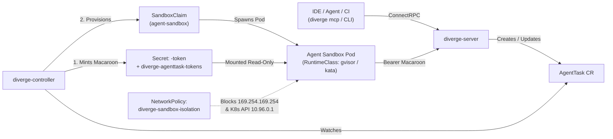

# Autonomous Agent Sandboxes & Capability Auth

Diverge includes a Kubernetes-native execution engine for autonomous coding agents (`AgentTask`). Each task runs inside a network-isolated sandbox pod (`kubernetes-sigs/agent-sandbox`), authenticates with an attenuated **Macaroon capability token**, and enforces strict iteration, USD cost, token, and wall-clock timeout guardrails.

---

## 1. Architecture Overview



### Key Security Properties
1. **Attenuated Macaroon Capability Tokens**:
   - Minted by `diverge-controller` using HMAC-SHA256 chained caveats (`task_id`, `namespace`, `repo`, `branch`, `tools`, `models`, `max_cost_usd`, `max_tokens`, `expires`).
   - Mounted read-only into the sandbox pod at `/etc/diverge/token/token`.
   - Verified by `diverge-server` against the namespace-scoped index Secret (`diverge-agenttask-tokens`) and live `AgentTask` phase (`Active`).
2. **Revocation on Pause, Budget Exceeded, or Completion**:
   - Setting `spec.suspended: true` or exceeding `maxIterations`, `budgetUSD`, or `budgetTokens` transitions the task to `Paused` and marks the token revoked in `diverge-agenttask-tokens` once reconciled by the controller.
   - Resuming a paused task mints a fresh capability token with updated budget/expiry caveats.
3. **Defense-in-Depth Network Isolation**:
   - The default `NetworkPolicy` (`<release>-sandbox-isolation`) denies all ingress to sandbox pods, restricts egress to DNS (53) and HTTPS/SSH (443/22), and blocks cloud metadata (`169.254.169.254/32`, `169.254.0.0/16`) and the in-cluster Kubernetes API (`10.96.0.1/32`).
   - Pod specs set `AutomountServiceAccountToken: false`, `ReadOnlyRootFilesystem: true`, `RunAsNonRoot: true`, and drop `ALL` Linux capabilities.

---

## 2. Enabling Agent Sandboxes in Helm

1. Create a 32-byte Macaroon root key Secret in the controller namespace:

```bash
kubectl create secret generic diverge-macaroon-root-key \
  -n diverge-system \
  --from-literal=root-key="$(openssl rand -hex 32)"
```

2. Install or upgrade the Diverge Helm chart with `sandbox.enabled=true` and `server.enabled=true`:

```bash
kubectl apply -f charts/diverge/crds/
helm upgrade --install diverge charts/diverge \
  --namespace diverge-system --create-namespace \
  --set server.enabled=true \
  --set sandbox.enabled=true \
  --set sandbox.provider=agent-sandbox \
  --set sandbox.macaroonSecretRef.name=diverge-macaroon-root-key \
  --set sandbox.networkPolicy.enabled=true
```

> [!TIP]
> For local Kind/k3d testing without the upstream `agents.x-k8s.io` CRDs installed, set `--set sandbox.provider=noop`.

---

## 3. Creating an `AgentTask`

Apply an `AgentTask` Custom Resource directly with `kubectl` or via `diverge mcp`:

```yaml
apiVersion: divergedev.com/v1alpha1
kind: AgentTask
metadata:
  name: fix-checkout-latency
  namespace: default
spec:
  objective: "Diagnose and fix N+1 query in /api/v1/checkout and verify in a preview environment"
  draftPR: true
  repository:
    url: https://github.com/myorg/checkout-service
    baseBranch: main
    workingBranch: fix/checkout-n-plus-1
  maxIterations: 8
  budgetUSD: "5.00"
  budgetTokens: 200000
  capabilities:
    - claude-3-7-sonnet
    - gemini-2.5-pro
  sandbox:
    provider: agent-sandbox
    templateName: default
    serviceAccountName: default
    timeoutSeconds: 1800
```

---

## 4. Steering & Pausing Tasks (`Paused` / `Active`)

### Pause Execution (`spec.suspended: true`)
Once the controller reconciles `spec.suspended: true`, it transitions the `AgentTask` to `Paused` and revokes its Macaroon token so subsequent tool calls to `diverge-server` are rejected with `401 Unauthenticated`:

```bash
kubectl patch agenttask fix-checkout-latency --type=merge -p '{"spec":{"suspended":true}}'
```

### Guide & Resume Execution
Use the `diverge_guide_task` / `diverge_resume_task` MCP tools or patch `spec.suspended: false` with an updated budget:

```bash
kubectl patch agenttask fix-checkout-latency --type=merge -p '{
  "spec": {
    "suspended": false,
    "budgetUSD": "10.00",
    "maxIterations": 12
  }
}'
```

When resumed, `diverge-controller` mints a new Macaroon capability token reflecting the updated `budgetUSD` and `maxIterations` limits and clears the revocation marker.
