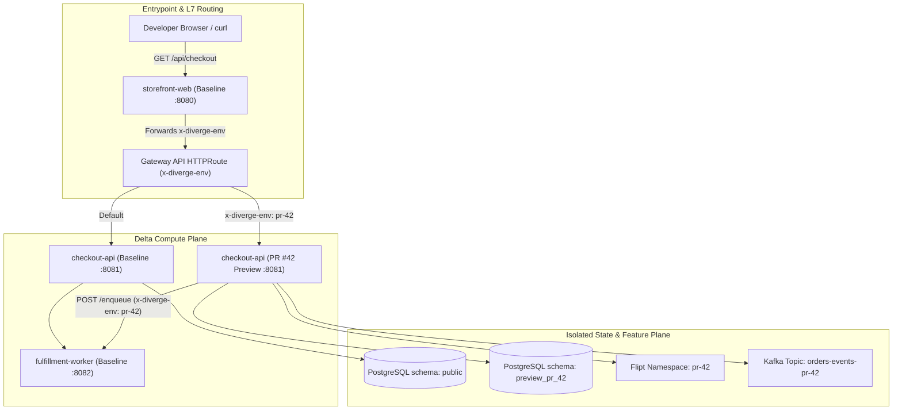

# Fullstack Multi-Service Demo Guide (`examples/fullstack-demo/`)

The [`examples/fullstack-demo/`](../../examples/fullstack-demo/) directory provides a runnable, in-repository reference monorepo with three Go microservices (`storefront-web`, `checkout-api`, `fulfillment-worker`), versioned SQL migrations for Atlas, and Kubernetes Custom Resource manifests covering all primary Diverge capabilities.

---

## What You Will Experience

| Capability | Where It Lives in the Demo |
| :--- | :--- |
| **Static Topology & Route Simulation** | [`examples/fullstack-demo/.diverge.yaml`](../../examples/fullstack-demo/.diverge.yaml) (`storefront-web -> checkout-api -> fulfillment-worker`) |
| **Delta Deployment (`PreviewGroup`)** | [`k8s/01-previewgroup-pr42.yaml`](../../examples/fullstack-demo/k8s/01-previewgroup-pr42.yaml) (`checkout-api` in `mode: image`; `storefront-web` and `fulfillment-worker` in `mode: baseline`) |
| **Context Header Propagation** | [`services/storefront-web/main.go`](../../examples/fullstack-demo/services/storefront-web/main.go) & [`services/checkout-api/main.go`](../../examples/fullstack-demo/services/checkout-api/main.go) (`x-diverge-env`, `x-preview-env`, `baggage`, `traceparent`) |
| **PostgreSQL Schema Isolation + Atlas** | [`migrations/`](../../examples/fullstack-demo/migrations/) (`preview_pr_42` schema + `20260902000000_add_instant_payouts.sql` with `destructive: error` policy) |
| **OpenFeature / Flipt Overrides** | `instant_payouts: "true"`, `checkout_v2_banner: "true"` scoped to PR #42 |
| **Async Kafka Routing** | `orders-events` topic mapped to `ORDERS_QUEUE_TOPIC=orders-events-pr-42` |
| **Scale-to-Zero Idle Hibernation** | [`k8s/02-environment-scale-to-zero.yaml`](../../examples/fullstack-demo/k8s/02-environment-scale-to-zero.yaml) (`divergedev.com/hibernate-after: "15m"` + KEDA `minReplicas: 0`) |
| **Autonomous AI Agent Sandbox (`AgentTask`)** | [`k8s/03-agenttask-fix-checkout.yaml`](../../examples/fullstack-demo/k8s/03-agenttask-fix-checkout.yaml) (`gvisor` sandbox, `$5.00` / `200,000` token budget, linked `checkout-api` preview) |

---

## Topology & Delta Routing Architecture



---

## Step 1: Validate Config, Topology & Routing (No Cluster Needed)

Run the workshop script in `--dry-run` mode from the repository root:

```bash
./examples/fullstack-demo/scripts/run-demo.sh --dry-run
```

Or run each CLI command directly:

```bash
# 1. Validate .diverge.yaml against the embedded JSON Schema
diverge validate -c examples/fullstack-demo/.diverge.yaml

# 2. Validate the service dependency graph for cycles and entrypoints
diverge graph validate -n default --config examples/fullstack-demo/.diverge.yaml

# 3. Simulate how requests with x-diverge-env reach checkout-api
diverge route checkout-api -n default --config examples/fullstack-demo/.diverge.yaml
```

Expected output from `diverge route checkout-api`:

```text
Request routing for "checkout-api":

  1. Client request with header: x-diverge-env: <env-name>
  2. → storefront-web (entrypoint)
     Route: HTTPRoute matching header
  3. → checkout-api ✓

  Path: storefront-web → checkout-api (1 hops)
  Header: x-diverge-env propagated at each hop ✓
```

---

## Step 2: Run the Automated In-Process E2E Test

You can verify the complete 3-service call chain, header propagation, schema isolation metadata, and feature flag overrides without Docker or Kubernetes by running the Go integration test suite:

```bash
go test -race -v ./examples/fullstack-demo/...
```

`TestFullstackDemoEndToEndHeaderRouting` spins up `httptest.NewServer` instances for:
- `fulfillment-worker` (baseline)
- `checkout-api` (baseline with `DIVERGE_PREVIEW_SCHEMA=public`, `FEATURE_INSTANT_PAYOUTS=false`)
- `checkout-api` (PR #42 preview with `DIVERGE_PREVIEW_SCHEMA=preview_pr_42`, `FEATURE_INSTANT_PAYOUTS=true`, `ORDERS_QUEUE_TOPIC=orders-events-pr-42`)
- An L7 header-routing reverse proxy matching `x-diverge-env: pr-42`
- `storefront-web` (baseline)

---

## Step 3: Deploy to a Local Cluster

1. **Ensure a local Kind or k3d cluster is running with Diverge installed** (see [2-Minute Local Quickstart](quickstart-local.md)):
  ```bash
  diverge init --provider kind --cluster-name diverge-local
  ```

2. **Apply the baseline services and PR #42 preview manifests**:
  ```bash
  ./examples/fullstack-demo/scripts/run-demo.sh --live
  ```

3. **Compare baseline vs. preview responses**:
  ```bash
  kubectl port-forward -n default svc/storefront-web 8080:8080
  ```

  **Baseline traffic (no header)**:
  ```bash
  curl -s http://localhost:8080/api/checkout | jq .
  ```
  ```json
  {
    "storefrontEnv": "baseline",
    "propagatedHeader": "",
    "checkout": {
      "service": "checkout-api",
      "environment": "baseline",
      "databaseSchema": "public",
      "databaseConfigured": false,
      "instantPayoutsEnabled": false,
      "checkoutV2Banner": false,
      "ordersQueueTopic": "orders-events",
      "receivedPreviewHeader": "",
      "workerResponse": {
        "service": "fulfillment-worker",
        "environment": "baseline",
        "ordersQueueTopic": "orders-events",
        "consumerGroup": "orders-cg-baseline",
        "receivedPreviewHeader": ""
      }
    }
  }
  ```

  **Preview traffic (`x-diverge-env: pr-42`)**:
  ```bash
  curl -s -H "x-diverge-env: pr-42" http://localhost:8080/api/checkout | jq .
  ```
  ```json
  {
    "storefrontEnv": "baseline",
    "propagatedHeader": "pr-42",
    "checkout": {
      "service": "checkout-api",
      "environment": "pr-42",
      "databaseSchema": "preview_pr_42",
      "databaseConfigured": true,
      "instantPayoutsEnabled": true,
      "checkoutV2Banner": true,
      "ordersQueueTopic": "orders-events-pr-42",
      "receivedPreviewHeader": "pr-42",
      "workerResponse": {
        "service": "fulfillment-worker",
        "environment": "baseline",
        "ordersQueueTopic": "orders-events",
        "consumerGroup": "orders-cg-baseline",
        "receivedPreviewHeader": "pr-42"
      }
    }
  }
  ```

---

## Step 4: Inspect Scale-to-Zero & Autonomous AgentTask Manifests

- **Scale-to-Zero (`k8s/02-environment-scale-to-zero.yaml`)**: Demonstrates `divergedev.com/hibernate-after: "15m"` combined with KEDA `minReplicas: 0`, `maxReplicas: 5`, and `cooldownPeriod: 300`.
- **Autonomous Agent Sandbox (`k8s/03-agenttask-fix-checkout.yaml`)**: Demonstrates an `AgentTask` targeting `checkout-api` with `divergedev.com/preview-enabled: "true"`, `divergedev.com/preview-service: "checkout-api"`, `budgetUSD: "5.00"`, `budgetTokens: 200000`, and `gvisor` sandbox isolation.
