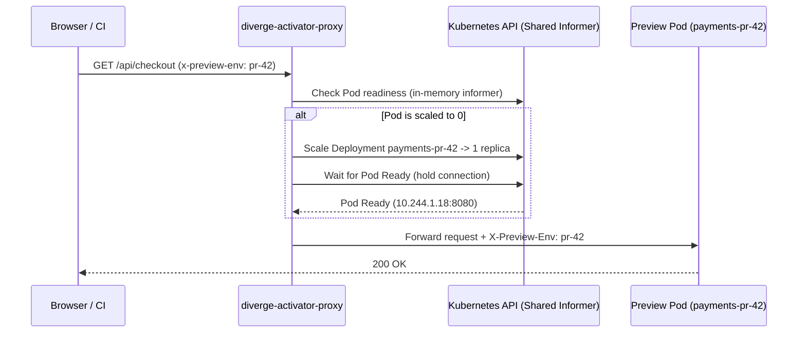

# Scale-to-Zero & Activator Proxy Guide

Idle preview environments typically sit unused for 90%+ of a pull request's lifetime (overnight, between code reviews, or while waiting on CI). Diverge's **Scale-to-Zero** architecture scales idle preview pods to `0` replicas and wakes them transparently on the first incoming HTTP/gRPC request.

---

## 1. How It Works



Diverge supports two scale-to-zero mechanisms:
1. **Built-in `activator-proxy`** (`activatorProxy.enabled: true`) — Uses a Kubernetes shared informer to track pod readiness in-memory, holds the HTTP request until the pod passes readiness probes, and injects `X-Preview-Env`.
2. **KEDA HTTP Add-on (`HTTPScaledObject`)** — Reconciles a KEDA `HTTPScaledObject` per `Environment` when `spec.serviceConfig.keda.enabled: true`.

---

## 2. Cost Savings Calculator

| Concurrent Open PRs | Avg Services Changed / PR | Pod Memory / Service | Always-On RAM | With Delta Deploy + Scale-to-Zero (15m idle timeout) | Monthly Cloud Savings (est.) |
| :--- | :--- | :--- | :--- | :--- | :--- |
| 25 PRs | 2 of 15 services | 512 MiB | ~192 GiB (full stack) | **~4 GiB active avg** | **~95% reduction** |
| 50 PRs | 3 of 20 services | 1 GiB | ~1,000 GiB (full stack) | **~18 GiB active avg** | **~97% reduction** |
| 100 PRs | 3 of 25 services | 1 GiB | ~2,500 GiB (full stack) | **~35 GiB active avg** | **~98% reduction** |

---

## 3. Enabling Scale-to-Zero in Helm & Environment CRs

Enable the activator proxy in your Helm values:

```yaml
activatorProxy:
  enabled: true
  replicaCount: 2
```

And configure KEDA scale-to-zero on your `Environment` via `spec.serviceConfig.keda`:

```yaml
apiVersion: divergedev.com/v1alpha1
kind: Environment
metadata:
  name: payments-pr-42
spec:
  serviceName: payments-api
  image: ghcr.io/acme/payments:pr-42
  serviceConfig:
    keda:
      enabled: true
      cooldownPeriod: 300
      minReplicas: 0
      maxReplicas: 5
```
