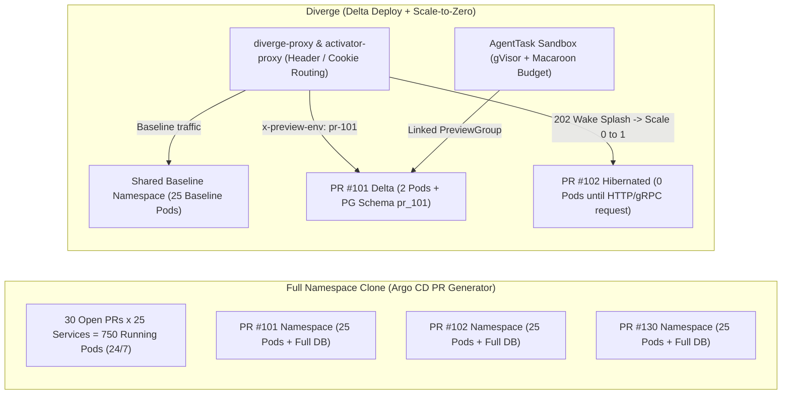

# Why Diverge?

Platform teams building ephemeral preview environments on Kubernetes inevitably hit a wall: how do you give every pull request and AI coding agent a realistic, isolated test environment without multiplying your cloud bill by the number of open PRs or shipping cluster metadata to a third-party SaaS?

Diverge was built from the ground up to solve this problem inside your own Kubernetes cluster.

> [!TIP]
> Try the **[Interactive Preview Cost & Savings Calculator](https://divergedev.com/guides/why-diverge/#interactive-preview-cost--savings-calculator)** on the Diverge documentation site to model your team's exact microservice count, open PR volume, and active testing hours.

---

## The Ephemeral Environment Trilemma

Engineering organizations typically evaluate three approaches to Kubernetes preview environments—each with a fundamental architectural flaw:

1. **Full Namespace Clones (Argo CD ApplicationSet PR Generator / Terraform per PR)**
   - Clones 100% of your microservices (`N services × M open PRs`) for every pull request—even for a 2-line change in one service.
   - Results in **astronomical cloud compute bills**, Kubernetes API server / etcd / CNI IP exhaustion, and **15+ minute cold spin-up times** waiting for duplicate databases, caches, and message brokers to boot.
2. **Local Laptop Intercepts (Telepresence / mirrord)**
   - Tunnels cluster traffic to a process running on a developer's laptop.
   - Great for interactive inner-loop debugging, but **dies the moment the laptop closes**, cannot run unattended in CI pipelines, cannot share a persistent preview URL with PMs or designers, and cannot isolate autonomous AI coding agents running in parallel.
3. **SaaS Control Planes (Signadot / Okteto)**
   - Requires connecting your clusters to an external vendor control plane, introduces per-seat or per-sandbox commercial lock-in, and lacks native open-source unification of database schema branching, OpenFeature flag isolation, and Macaroon-governed AI agent sandboxes (`AgentTask`).

### Architectural Footprint: Full Clone vs. Diverge Delta + Scale-to-Zero



---

## Head-to-Head Comparison Matrix

| Capability | **Diverge** | **Argo CD PR Generator (Full Clone)** | **Telepresence** | **Signadot** | **Okteto** |
| :--- | :--- | :--- | :--- | :--- | :--- |
| **1. Deployment Footprint** | **Delta Deploy** of changed services only (`PreviewGroup` + shared baseline fallback); also supports full-clone mode | Clones **100% of services** (`N × M` pods) per PR namespace | Local workstation process intercepting 1 service; no cluster-hosted PR lifecycle | Route-based sandboxes (`Sandbox` CRD) sharing baseline | Full namespace clone per developer/PR by default (or hybrid divert) |
| **2. Idle Resource Cost** | **Scale-to-Zero** via `activator-proxy` (`--wake-splash`), KEDA `HTTPScaledObject`, Knative, or native `divergedev.com/hibernate-after` idle hibernation | **24/7 running pods** for every open PR until PR merge/close | Runs on developer laptop CPU/RAM (dies when laptop sleeps) | Always-on sandbox pods while PR is open (TTL teardown, no built-in wake-splash activator) | Automated sleep/wake on commercial tiers; heavy full-stack footprint when awake |
| **3. Database Isolation** | **6-mode Database Provider** (`schema` per PR with auto-provisioned `DATABASE_URL` & `DIVERGE_PREVIEW_SCHEMA`, `neon`, `cnpg`, `cockroach`, `snapshot`, `shared`) + native **Ariga Atlas** migrations | Heavy full DB container per PR (slow, unseeded) or manual custom scripting | Manual local DB or shared staging DB (high risk of developer schema collisions) | Custom resource plugins (DIY scripts for schema/branch provisioning) | Volume snapshots or full DB container clones per namespace |
| **4. Async Message Queue Isolation** | **Native Kafka & Temporal** (`AsyncProvisioner` for isolated topics, consumer groups, and Temporal task queues) + Webhook provider | Requires duplicating Kafka/Temporal clusters per PR or manual topic prefixing | Primarily HTTP/gRPC L7 intercept; queues require manual consumer filtering | Requires application-level SDK header inspection & custom consumer routing | Full broker clone per namespace or manual topic isolation |
| **5. Feature Flag Isolation** | **Native OpenFeature** integration (`flagd` per-PR `ConfigMap` overrides & ephemeral **Flipt** namespaces auto-cleaned on PR merge) | Manual `ConfigMap` duplication or shared global feature flags | None built-in (shares cluster or local env flags) | None built-in (requires external flag provider routing rules) | None built-in |
| **6. Autonomous AI Agent Sandboxes** | **First-class `AgentTask` CRDs** with **gVisor / Kata** isolation, attenuated **Macaroon capability tokens**, linked previews, MCP server, & live `/api/v1/agenttask/meter` budget enforcement | None | None | None (focused on human/CI service sandboxes) | None (general dev containers without K8s-native Macaroon or LLM budget governance) |
| **7. Shareable Browser Previews** | **One-click `?_diverge_env=pr-42` URL cookie switcher** + optional floating preview switcher banner + auto-refreshing wake-up splash page — **no browser extension required** | Dedicated DNS hostname per PR (requires wildcard DNS + TLS per PR) | Requires commercial cloud login / browser extension and developer laptop online | Browser extension or SaaS proxy URLs | Subdomain URLs managed by Okteto proxy |
| **8. Control Plane & Licensing** | **100% self-hosted Kubernetes operator** + embedded React Web Dashboard & ConnectRPC API. **Apache 2.0 Open Source** | Self-hosted Kubernetes operator (Apache 2.0), but requires custom glue for DBs, routing, & cleanup | OSS client/traffic-manager + commercial control plane for team features | **Proprietary SaaS** control plane with in-cluster agent (commercial) | **Proprietary SaaS / Enterprise** self-hosted license |

---

## Preview Environment Cost & Savings Model

Diverge's controller exposes a built-in Prometheus gauge (`diverge_environment_estimated_hourly_cost_usd`) using the default on-demand Kubernetes compute rate card:

- **vCPU Rate**: `$0.031611 / vCPU-hr`
- **Memory Rate**: `$0.004237 / GiB-hr`
- **Per-Replica Hourly Rate (`0.5 vCPU + 1 GiB RAM`)**:
  ```text
  hourlyRate = (0.5 * $0.031611) + (1.0 * $0.004237) = $0.0200425 / pod-hr ($14.631 / pod-month at 730h/mo)
  ```

### Worked Cost Formulas (Default Baseline: 25 Services, 30 Open PRs, 2 Modified Services/PR, 4 Active Hours/Day)

1. **Full Namespace Clone Monthly Cost**:
   ```text
   services * openPRs * 730h * hourlyRate
   = 25 * 30 * 730 * $0.0200425 = $10,973.27 / month (750 always-on pods)
   ```
2. **Diverge Delta Deploy Monthly Cost (Always-On)**:
   ```text
   modifiedServices * openPRs * 730h * hourlyRate
   = 2 * 30 * 730 * $0.0200425 = $877.86 / month (60 delta pods — 92.0% reduction)
   ```
3. **Diverge Delta + Scale-to-Zero Monthly Cost (`4h/day` active, `20h/day` hibernated)**:
   ```text
   modifiedServices * openPRs * (activeHours / 24) * 730h * hourlyRate
   = 2 * 30 * (4 / 24) * 730 * $0.0200425 = $146.31 / month (10.0 active pod-equivalents)
   ```
4. **Net Cloud Compute Savings**:
   - **Monthly Savings**: `$10,973.27 - $146.31 = $10,826.96 / month` (**`98.7%` saved**)
   - **Annual Savings**: `$10,826.96 * 12 = $129,923.50 / year`

### Multi-Team Sizing Reference

| Team Profile | Baseline Services | Open PRs | Modified / PR | Active Hrs / Day | Full Clone / mo | Diverge Delta / mo | Diverge Delta + Scale-to-Zero / mo | **Annual Savings** |
| :--- | :---: | :---: | :---: | :---: | :---: | :---: | :---: | :---: |
| **Seed / Small Team** | `10` | `10` | `2` | `4h` | `$1,463` | `$293` | **`$49`** | **`$16,972 / yr` (96.7%)** |
| **Growth Engineering** | `25` | `30` | `2` | `4h` | `$10,973` | `$878` | **`$146`** | **`$129,924 / yr` (98.7%)** |
| **Scale-Up Platform** | `50` | `75` | `2` | `4h` | `$54,866` | `$2,195` | **`$366`** | **`$654,007 / yr` (99.3%)** |
| **Enterprise + AI Agents** | `100` | `150` | `3` | `4h` | `$219,465` | `$6,584` | **`$1,097`** | **`$2,620,416 / yr` (99.5%)** |
