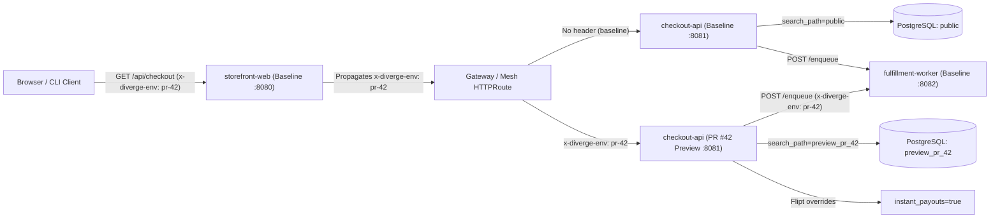

# Diverge Fullstack Demo Monorepo

This directory contains a complete, self-contained **3-service Go monorepo** (`storefront-web`, `checkout-api`, `fulfillment-worker`) demonstrating all core Diverge capabilities in a single workspace:

1. **Delta Deployment (`PreviewGroup`)**: Deploy only `checkout-api` for PR #42 (`ghcr.io/divergedev/demo-checkout-api:pr-42`) while sharing the baseline `storefront-web` and `fulfillment-worker` deployments.
2. **L7 Header & Query-Parameter Routing (`x-diverge-env: pr-42` / `?_diverge_env=pr-42`)**: Route preview requests through baseline `storefront-web` into the isolated `checkout-api` preview pod and propagate context headers (`x-diverge-env`, `x-preview-env`, `baggage`, `traceparent`) downstream to `fulfillment-worker` (when fronted by `diverge-proxy`, `?_diverge_env=pr-42` also sets an `_diverge_env` session cookie).
3. **PostgreSQL Schema-per-PR & Atlas Versioned Migrations**: Automatically provision the `preview_pr_42` PostgreSQL schema and execute versioned SQL migrations (`migrations/`) via an Atlas migration job with `destructive: error` linting.
4. **OpenFeature / Flipt Per-Preview Flag Overrides**: Override `instant_payouts=true` and `checkout_v2_banner=true` exclusively for PR #42 traffic.
5. **Async Kafka Queue & Consumer Group Isolation**: Route async order events for PR #42 to an isolated Kafka topic (`ORDERS_QUEUE_TOPIC=orders-events-pr-42`).
6. **Scale-to-Zero Idle Hibernation (`divergedev.com/hibernate-after: "15m"`)**: Automatically hibernate idle preview pods to zero replicas and wake them on the first HTTP request via `activator-proxy`.
7. **Autonomous AI Coding Sandbox (`AgentTask`)**: Spin up an isolated `gvisor` sandbox with an attenuated Macaroon capability token, `$5.00` / `200,000` token budget, and an automatically linked `checkout-api` preview environment.

---

## Architecture & Request Flow



---

## Directory Layout

```text
examples/fullstack-demo/
├── .diverge.yaml                           # Schema-validated Diverge monorepo config
├── handlers.go                             # Shared HTTP handlers for the 3 Go services
├── handlers_test.go                        # Unit tests for handlers, masking, & HTML escaping
├── demo_test.go                            # Automated E2E header-routing, DAG, & CRD tests
├── services/
│   ├── storefront-web/main.go              # Entrypoint service (:8080) — propagates headers
│   ├── checkout-api/main.go                # Mid-tier API (:8081) — DB schema + Flipt flags
│   └── fulfillment-worker/main.go          # Async worker (:8082) — Kafka topic + consumer group
├── migrations/
│   ├── 20260901000000_initial_orders.sql   # Baseline orders table
│   ├── 20260902000000_add_instant_payouts.sql # PR #42 migration adding payout_speed column
│   ├── atlas.sum                           # Atlas migration directory integrity checksums
│   └── atlas.hcl                           # Atlas versioned migration config + destructive policy
├── k8s/
│   ├── 00-baseline.yaml                    # Baseline Deployments, Services, & migrations ConfigMap
│   ├── 01-previewgroup-pr42.yaml           # PreviewGroup CR (delta deploy of checkout-api)
│   ├── 02-environment-scale-to-zero.yaml   # Scale-to-zero Environment CR (15m idle hibernation)
│   └── 03-agenttask-fix-checkout.yaml      # AgentTask CR (gVisor sandbox + $5.00 budget)
└── scripts/
  └── run-demo.sh                           # Interactive workshop script (--dry-run or --live)
```

---

## Quick Verification (No Cluster Required)

Run the automated end-to-end test suite (spins up `httptest` servers for all 3 microservices and a simulated L7 header router):

```bash
go test -race -v ./examples/fullstack-demo/...
```

Run the workshop script in `--dry-run` mode to validate `.diverge.yaml`, verify the service dependency DAG, and trace the routing path from `storefront-web` to `checkout-api`:

```bash
./examples/fullstack-demo/scripts/run-demo.sh --dry-run
```

---

## Running on a Local Kubernetes Cluster (Kind / k3d)

1. **Bootstrap a local cluster with Diverge**:
  ```bash
  diverge init --provider kind --cluster-name diverge-demo
  ```

2. **Run the workshop script in live mode**:
  ```bash
  ./examples/fullstack-demo/scripts/run-demo.sh --live
  ```

3. **Test baseline vs. PR #42 preview traffic**:
  ```bash
  # Port-forward the baseline storefront-web entrypoint
  kubectl port-forward -n default svc/storefront-web 8080:8080

  # 1. Baseline request (routes to baseline checkout-api, public schema, instantPayoutsEnabled=false)
  curl -s http://localhost:8080/api/checkout | jq .

  # 2. PR #42 preview request (routes through baseline storefront-web -> pr-42 checkout-api, preview_pr_42 schema, instantPayoutsEnabled=true)
  curl -s -H "x-diverge-env: pr-42" http://localhost:8080/api/checkout | jq .
  ```

See the full walkthrough in [`docs/guides/fullstack-demo.md`](../../docs/guides/fullstack-demo.md).
